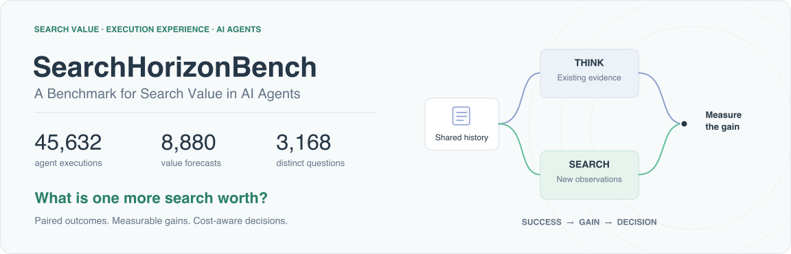
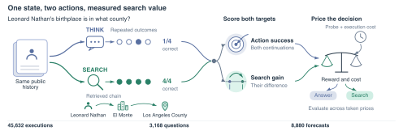

<div align="center">

# SearchHorizonBench

### A Benchmark for Search Value in AI Agents



[](https://ethanning.github.io/SearchHorizonBench/)
[](https://ethanning.github.io/SearchHorizonBench/assets/SearchHorizonBench.pdf)
[](DATA_CARD.md)
[](DATA_CARD.md)
[](DATA_CARD.md)

**What is one more search worth?**

Learn from execution experience. Predict the benefit of searching. Account for the cost of the decision.

[Quick start](#quick-start) · [Evaluate a forecaster](#evaluate-your-forecaster) · [Interactive results](https://ethanning.github.io/SearchHorizonBench/#explore) · [Download the benchmark](https://ethanning.github.io/SearchHorizonBench/downloads/SearchHorizonBench.zip) · [Citation](#paper-and-citation)

</div>

SearchHorizonBench evaluates whether an AI agent can estimate what another search will add to its answer. From the same saved history, an actor either answers with the available evidence or searches further. Repeated continuations support three complementary measurements: action-success prediction, expected search gain, and decision utility after information costs.

## The benchmark at a glance



| Target | The question | Evaluation |
| --- | --- | --- |
| **Answer success** | How likely is each continuation to answer correctly? | Action-level Brier error |
| **Search gain** | How much does another search improve expected reward? | Generation-noise-corrected gain error and gain R² |
| **Decision value** | Does the additional reward justify the information cost? | Reward minus token cost, against matched constant policies |

The full study covers **45,632 distinct actor executions**, **8,880 forecasts**, and **3,168 questions**. It spans DeepSeek Flash and Pro, Qwen, commercial retrieval interfaces, ClueWeb22 and FineWeb, multi-hop and open-domain QA, and set-completion tasks. This repository contains the exported scoring records, frozen predictions, numerical evaluators, and runnable replay examples.

## What the evidence establishes

- **Success calibration and search-value prediction measure distinct abilities.** On Test-1632, historical correction reduces Brier error by **16.2%**. Success-level prediction accounts for **99.9%** of the reduction, and task-category priors recover **88.9%** of the observed improvement.
- **Question-specific search gains provide a substantial prediction target.** Their estimated standard deviation is **21.4 percentage points**. Tested historical estimators explain less than **2%** of gain variance in point estimates. Matched-configuration learning curves extend the comparison from 20 to 1,100 training questions.
- **Gain information creates measurable decision opportunity.** At a token valuation of 0.005 per thousand tokens, a finite-sample selector gains **2.49 utility points** over the best constant action with its selection observations provided free. Gain information with fixed costs retains **2.48 points**; cost information with fixed gain gives **0.68 points**. The benchmark separately evaluates methods that pay for their decision signals.

Explore all five token valuations and their uncertainty intervals on the [project page](https://ethanning.github.io/SearchHorizonBench/#explore). The [paper](https://ethanning.github.io/SearchHorizonBench/assets/SearchHorizonBench.pdf) defines the scoring targets, repeated-draw design, task weighting, and statistical comparisons.

## Quick start

Use **Python 3.10+**. The saved-data replay uses NumPy and runs locally without model or search API credentials.

```bash
git clone https://github.com/EthanNing/SearchHorizonBench.git
cd SearchHorizonBench
python -m venv .venv
source .venv/bin/activate
python -m pip install -r requirements.txt
python scripts/replay_examples.py
```

The command reproduces three examples and checks the results against `examples/expected_replay.json`. It writes the resulting reports to `results/`.

| Replayed quantity | Expected value |
| --- | ---: |
| Test-1632 calibrated action-success Brier | 0.1796987195 |
| Test-1632 generation-noise-corrected gain MSE | 0.0458585746 |
| Test-1632 priced calibrated-policy utility | 0.6665569409 |
| Collection-96 calibrated gain MSE | 0.0264415565 |

The first two quantities use reference-equivalent correctness and equal mass for each of five task categories. Policy utility charges predictor and actor API tokens at 0.005 reward units per thousand tokens. The collection example uses bounded set F1 on its own 96-task population.

## Evaluate your forecaster

**1. Read the public inputs.** Use each record's `input` object in `data/forecast_benchmark/cost_confirmation/semantic_flash_v1_inputs.jsonl`. Keep `unit_id` unchanged so the evaluator can join your predictions to the saved outcomes.

**2. Predict both continuations.** Write one JSON object per line.

```json
{"unit_id":"<unchanged unit_id>","status":"ok","delta":0.1,"p_reuse_correct":0.5,"p_new_correct":0.6,"inference_API_tokens":128}
```

`p_reuse_correct` and `p_new_correct` are the expected rewards for THINK and SEARCH. Their difference gives `delta`, the predicted search gain. `inference_API_tokens` records the actual cost of obtaining the prediction.

**3. Score success, gain and decisions.**

```bash
python scripts/score_value_forecasts.py \
  --draws data/forecast_benchmark/cost_confirmation/semantic_flash_v1_draws.jsonl \
  --predictions my_predictions.jsonl \
  --actor-model deepseek-flash \
  --baseline data/forecast_benchmark/cost_confirmation/source120_baseline.json \
  --weighting equal_strata \
  --output results/my_value_scores.json

python scripts/score_search_policy.py \
  --draws data/forecast_benchmark/cost_confirmation/semantic_flash_v1_draws.jsonl \
  --predictions my_predictions.jsonl \
  --actor-model deepseek-flash \
  --mean-extra-tokens 7007.49375 \
  --penalty 0.005 \
  --weighting equal_strata \
  --output results/my_policy_scores.json
```

For collection tasks, predict a three-element `values` array in the action order stored in each outcome record, together with `task_id` and `kind`. Use `kind="expected_rewards"` for expected set F1 or `kind="relative_gains"` for gains relative to the first action.

```bash
python scripts/score_collection_forecasts.py \
  --draws data/forecast_benchmark/collection_value/test_draws.jsonl \
  --predictions my_collection_predictions.jsonl \
  --output results/my_collection_scores.json
```

## Data and evaluation

Saved **public histories** define the forecaster inputs. Reference answers, repeated outcome draws, supporting-page components, task strata, and selection flags belong to the evaluator. Development records support fitting; freeze a predictor before inspecting its test outcomes. A new prospective evaluation uses an independent cohort.

The record keys `reuse` and `new` denote THINK and SEARCH in the binary track. Repeated answer strings share reward-case identities. Each endpoint retains its scoring rule, and unresolved semantic labels preserve their shared-case assignments in risk bounds. Predictor costs and continuation costs remain explicit.

`manifest.json` lists the exported files, row counts, and sizes. Several endpoints evaluate the same executions, so exported row counts and the study's unique-execution count describe different quantities. The compact scoring artifact includes saved inputs, outcomes, forecasts and evaluators. Full provider request logs, search caches and training artifacts remain in the research archive.

Read the [data card](DATA_CARD.md) for populations, reward definitions and evaluation units, and [source attribution](ATTRIBUTION.md) for dataset and corpus references.

## Repository guide

```text
data/forecast_benchmark/   Saved inputs, outcomes, baseline forecasts, metadata
search_horizon/           Numerical scoring and statistical utilities
scripts/                  Forecast, policy, collection and example-replay entrypoints
examples/                 Reference outputs used by the offline replay
results/                  Replayed evaluation reports
docs/                     Project website, manuscript and visual assets
DATA_CARD.md              Populations, targets and evaluation units
ATTRIBUTION.md            Dataset and corpus sources
manifest.json             Exported-file inventory
```

## Paper and citation

**SearchHorizonBench: A Benchmark for Search Value in AI Agents**

Jingjie Ning, Xueqi Li, Yibo Kong<br>
Carnegie Mellon University<br>
Corresponding author: [Jingjie Ning](mailto:jening@cs.cmu.edu)

[Read the paper](https://ethanning.github.io/SearchHorizonBench/assets/SearchHorizonBench.pdf) · [Explore the project](https://ethanning.github.io/SearchHorizonBench/)

```bibtex
@misc{ning2026searchhorizonbench,
  title = {SearchHorizonBench: A Benchmark for Search Value in AI Agents},
  author = {Ning, Jingjie and Li, Xueqi and Kong, Yibo},
  year = {2026},
  note = {Manuscript and benchmark},
  url = {https://ethanning.github.io/SearchHorizonBench/}
}
```

Questions about the benchmark can be directed to [jening@cs.cmu.edu](mailto:jening@cs.cmu.edu), [xueqil@cs.cmu.edu](mailto:xueqil@cs.cmu.edu), or [yibok@cs.cmu.edu](mailto:yibok@cs.cmu.edu).
